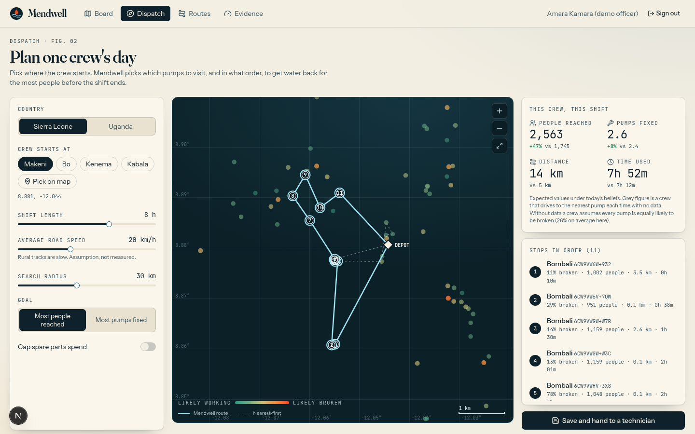
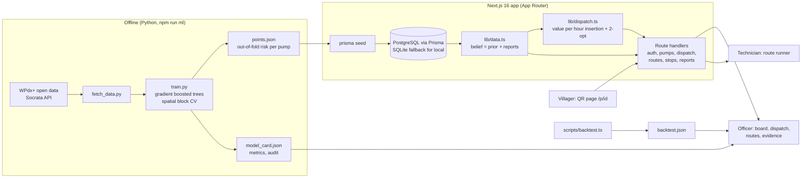

# Mendwell

Hand pump failure triage for rural water access. Entry for the Xylem Global Student Innovation Challenge 2026, challenge #3 Water Access, University track.

Mendwell does three jobs:

1. **Rank.** A model scores about 35,000 real hand pumps in Sierra Leone and Uganda by the chance each one is broken today.
2. **Plan.** It builds one technician's day: which pumps to visit and in what order, so the most people get water back before the shift ends.
3. **Report.** A villager scans a QR sticker on the pump and reports it in two taps. No app, no account. Reports move the pump's score and the next day's plan.

Screenshots are in `docs/screenshots`. The demo video script and project page text are in `docs/`.



## Run it

Needs Node 20+ (tested on Node 22 and 24). No Python is needed to run the app. The trained scores and datasets are in `data/`.

**Fastest, no database server (SQLite, local only):**

```bash
npm install
npm run demo:sqlite   # builds a SQLite copy of the schema, seeds it, starts http://localhost:3000
```

**PostgreSQL (what production uses):**

```bash
npm install
cp .env.example .env          # set DATABASE_URL to any Postgres (local, Docker or a Neon project) and AUTH_SECRET
npm run demo                  # prisma db push, seed, then next dev on http://localhost:3000
```

For example, a throwaway local Postgres: `docker run -d -p 5432:5432 -e POSTGRES_PASSWORD=pw -e POSTGRES_DB=mendwell postgres:16`, then `DATABASE_URL="postgresql://postgres:pw@localhost:5432/mendwell"`.

After `demo:sqlite`, run `npx prisma generate` (or `npm install`) to switch the generated client back to PostgreSQL.

Demo logins (password for both: `mendwell-demo`):

| Role | Email | Sees |
|---|---|---|
| Officer | officer@mendwell.demo | Board, Dispatch, Routes, Evidence |
| Technician | tech@mendwell.demo | Their saved routes and the route runner |

Pages: `/` landing, `/board`, `/dispatch`, `/routes`, `/route/demo-route`, `/evidence`, and the public report page `/p/<pump id>` (no login).

Other scripts:

```bash
npm run build && npm start   # production build
npm run lint
npm run ml                   # re-download data and retrain (needs Python, see ml/requirements.txt)
npm run backtest             # re-run the dispatch backtest, writes data/backtest.json
```

## How the demo is staged

The pump census (the real survey) records whether each pump was working on the survey day. We use it as ground truth for a replay:

- The census status is **never sent to the planner or the browser**. `lib/data.ts` does not select it.
- It is revealed only when a technician taps "I'm here" on a stop, standing in for the inspection a real crew would do.
- Seeded community reports are simulated and labelled "simulated" in the UI. Reports sent from the public page are real rows.
- Each pump's model score is **out of fold**: it comes from a model that never saw that pump's area during training.

## Architecture



Stack: Next.js 16 (App Router), React 19, TypeScript, Tailwind 4, shadcn/ui on Base UI, Framer Motion, Prisma 6 with SQLite, `jose` JWT cookie auth, `bcryptjs`, `zod`, `qrcode`. The map and charts are hand built (canvas and SVG), with no map tile service and no API keys.

Data model (`prisma/schema.prisma`, PostgreSQL): `User`, `Pump`, `Report`, `Route`, `Stop`. It uses portable types only, which is why the SQLite fallback can reuse the same file. The seeded database is about 18 MB, well inside the Neon free tier (0.5 GB).

## Data and citations

| Data | Use | Source |
|---|---|---|
| WPdx+ (Water Point Data Exchange), Sierra Leone: 2016 national water point mapping, Ministry of Water Resources | Pumps, features, outcome labels | https://data.waterpointdata.org (Socrata dataset `eqje-vguj`, WPdx+) |
| WPdx+, Uganda: 2009 national water point inventory, Ministry of Water and Environment | Same | Same dataset |
| WHO/UNICEF JMP, *Progress on household drinking water, sanitation and hygiene 2000-2024* (2025) | Problem size: about 2.1 billion people without safely managed drinking water | https://data.unicef.org/resources/jmp-report-2025/ |
| Foster, Furey, Banks, Willetts, *Functionality of handpump water supplies: a review of data from sub-Saharan Africa and the Asia-Pacific region*, Int. J. Water Resources Development, 2019 | About one in four handpumps in sub-Saharan Africa are non-functional at any point in time (26%, about 175,000 pumps, in 2015) | https://doi.org/10.1080/07900627.2018.1543117 |

Check each citation against the page before you quote it in the video or slides. The survey years matter: the app replays old surveys, it does not claim today's status of those pumps.

Not used: India. WPdx+ has India records, but the labels come from several import sources and about three quarters of them look like import artifacts, so any score there would be noise. The Evidence page says so.

## The model, with honest numbers

Task: predict whether a pump was non-functional on survey day, from what a ministry knows before visiting (age, technology, management, installer, distance to roads and towns, local population, people served, coordinates).

- Gradient boosted trees (`HistGradientBoostingClassifier`, depth 4, 250 iterations, L2 2.0).
- **Spatial block cross-validation**: 5 folds, grouped by 0.1 degree grid cell (about 11 km), so neighbouring pumps never sit on both sides of a split.
- 95% CI by block bootstrap. Permutation importance. Reliability and lift curves in `data/model_card.json` and on `/evidence`.

| | Sierra Leone | Uganda |
|---|---|---|
| Pumps / share broken | 10,928 / 26.8% | 24,574 / 18.9% |
| Survey year | 2016 | 2009 |
| AUC (spatial CV) | 0.678 (95% CI 0.663 to 0.693) | 0.727 (0.715 to 0.741) |
| Baseline: logistic on age and technology | 0.583 | 0.586 |
| Brier score vs prevalence only | 0.179 vs 0.196 | 0.135 vs 0.153 |
| Top 5% by risk: share actually broken / lift | 65% / 2.4x | 55% / 2.9x |

Read this as a modest model. It ranks better than chance and better than a simple baseline, and it is well enough calibrated to feed a planner. It cannot tell you that a given pump is down.

Checks that keep it honest:

- **Leakage audit.** Our first model scored AUC 0.99 in Sierra Leone. The cause was `pay_clean`, `crucialness` and `pressure`, which WPdx+ derives from the status. They are excluded, and the audit AUC is stored in the model card.
- **Transfer test.** Trained on Sierra Leone, tested on Uganda with shared features only: AUC 0.52. Each country needs its own model, so the app does not pretend otherwise.

## The planner and its backtest

The planner solves a small orienteering problem: pick stops and an order to maximise expected people restored per hour, within the shift, and return to the depot. Insertion by value per hour, then 2-opt. The value of a stop is `P(broken) x people served`. Distance is not subtracted from value. It costs shift time, which the ratio already accounts for.

`lib/risk.ts` turns community reports into likelihood ratios (report accuracy assumed 0.85), decays them with a 14 day half-life, and adds them to the model's log-odds.

Backtest (`scripts/backtest.ts`): 220 random depots per country, an 8 hour shift, 20 km/h average road speed, 0.3 h per inspection, 1.5 h per repair, 30 km search radius. Outcomes are the real census statuses. Values are per shift, averages over depots. Full table with standard errors on `/evidence`.

| Sierra Leone | People back on water | Pumps fixed |
|---|---|---|
| Nearest pump first, no data | 828 | 1.96 |
| Highest risk first, ignores distance | 2,040 | 1.32 |
| Planner without the model | 2,274 | 1.63 |
| **Mendwell planner** | **2,526** | 1.80 |
| Mendwell planner + simulated community reports (5% of pumps) | 2,823 | 1.87 |
| Planner, objective "most pumps fixed" | 990 | **2.42** |
| Upper bound (knows every status) | 4,441 | 2.85 |

Uganda: nearest first 879 people, planner 1,933, planner with reports 1,923, upper bound 4,055. In Uganda the "most pumps fixed" planner reaches 1.58 repairs against 1.51 for nearest first, a small gap.

What this says, and what it does not:

- Most of the gain comes from choosing busy pumps and routing well. The model adds a smaller part on top (2,274 to 2,526 people).
- With the people objective the planner fixes slightly fewer pumps than nearest first (1.80 against 1.96). It trades repair count for people reached. The pump-count objective is in the app as a switch.
- Road speed, inspection time and repair time are assumptions. Planner against nearest first is shown at 12, 20 and 30 km/h on `/evidence`. The gain holds across them, but it shrinks at lower speeds.
- The reports result uses simulated reports. It shows the mechanism works, not that villagers will report at that rate.

## Judging criteria mapping

| Criterion | Where Mendwell answers it |
|---|---|
| **Impact** | The problem is large: JMP 2025 counts about 2.1 billion people without safely managed drinking water, and about a quarter of handpumps in sub-Saharan Africa are down at any time. The app covers 35,502 real pumps and about 1.3 million people behind probably-broken pumps in the Sierra Leone view alone. A technician reaches 3.1 times as many people per shift in the backtest. |
| **Challenge fit and feasibility** | Water Access, reliability of existing services. It runs end to end with a real database, auth and roles, and open data. Every claim has a test on real outcomes, assumptions are stated, and the limits section below says what is not proven. Hosting needs only free tiers. |
| **Innovation** | Triage of the repair crew's day, not another sensor. People-weighted dispatch, a no-account reporting path that feeds the plan, spatial-block validation, a published leakage audit, and a replay design that keeps the answer hidden from the planner. |

## Deploy (Vercel + Neon, free tiers)

Environment variables (two only):

| Name | Value |
|---|---|
| `DATABASE_URL` | Neon connection string, ending in `?sslmode=require`. Use the pooled string on Vercel. Use the direct (non-pooled) string for the one-time seed below. |
| `AUTH_SECRET` | A random string of at least 32 characters, for example `openssl rand -base64 48`. |

Steps:

1. Create a Neon project (free tier) and copy the connection strings.
2. From your machine, once: `DATABASE_URL="<direct string>" npm run setup`. This creates the tables and seeds about 35,500 pumps, the two demo users and a demo route. The seed wipes the tables first, so run it only on this demo database.
3. In Vercel, import the GitHub repo (framework: Next.js, no build command changes). Add `DATABASE_URL` (pooled) and `AUTH_SECRET`. Deploy.
4. Open the site, sign in as `officer@mendwell.demo` (password `mendwell-demo`) and check the board loads.

`postinstall` runs `prisma generate`, so Vercel builds the PostgreSQL client without extra setup.

## Limits

- The data are old surveys (Sierra Leone 2016, Uganda 2009). Many of those pumps have changed since. The app is a replay, not a live status of any pump.
- AUC 0.68 and 0.73 are modest. The model is a ranking aid for a crew that has no other information, not a diagnosis.
- Routing uses straight-line distance times 1.4, not real roads.
- Simulated reports are 5% of pumps and are labelled. Real report volume and accuracy are unknown. Rate limiting is in memory and honeypot only, so a determined spammer is not stopped. Production needs a proper abuse control.
- One crew, one depot, one day. No fleet scheduling, parts stock or weather.
- Demo accounts and the shared password are for the demo only.
- No pilot with a water agency yet. That is the next step.

## Layout

```
app/            pages and route handlers (App Router)
components/     map, board, dispatch, route runner, report form, charts, ui (shadcn)
lib/            risk, dispatch, plan-service, data, auth, geo
prisma/         schema and seed
ml/             data download and training (Python)
scripts/        backtest
data/           raw CSVs, points.json, model_card.json, backtest.json
docs/           project page text and video script
```

## Licence

MIT, see `LICENSE`. The WPdx+ data keep their own terms: see https://www.waterpointdata.org.
